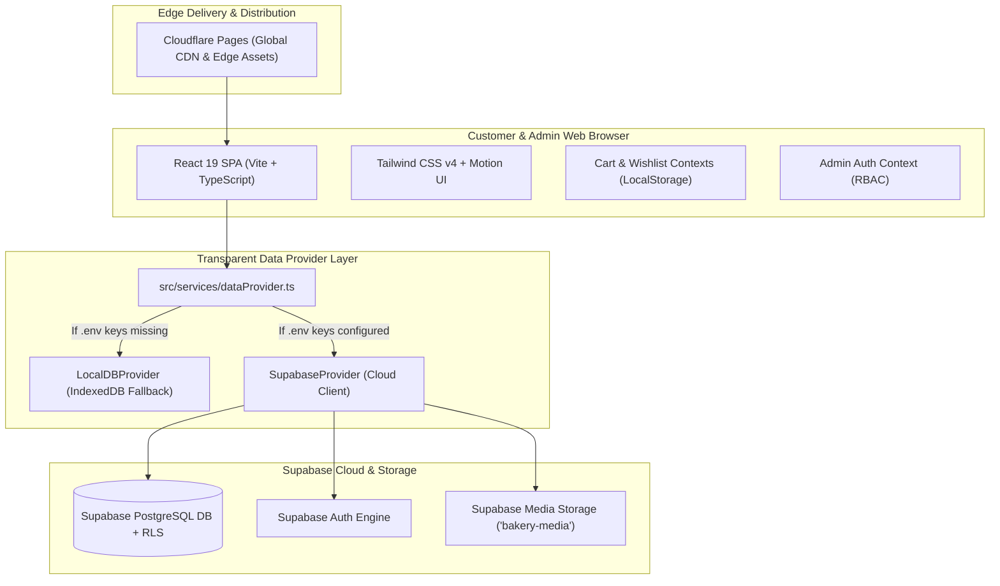

# SYSTEM ARCHITECTURE — CAKES & DESSERT
**Project:** Cakes & Dessert Luxury Boutique Platform  
**Architecture Document**

---

## 1. High-Level Architectural Diagram

---

## 2. Frontend Architecture

- **React 19 & TypeScript:** Strict type checking, zero `any` usage in domain models, component modularity.
- **Tailwind CSS v4:** Theme variables mapped to luxury chocolate & blush palette (`--color-chocolate: #4B2923`, `--color-blush: #E9AEBB`, `--color-cream: #FFF7F0`).
- **Motion for React / Framer Motion:** Micro-interactions, slide drawers, staggered reveals, and responsive modal transitions honoring `prefers-reduced-motion`.
- **Zod Validation:** Comprehensive schema validation for phone numbers (Indian format `^[6-9]\d{9}$`), pincodes (6-digit format `^[1-9][0-9]{5}$`), customer data, and image file types.
- **Route-Level Code Splitting:** Major pages are lazy-loaded via `React.lazy` and `Suspense`, ensuring fast initial page loads.

---

## 3. Data Provider Pattern (`dataProvider.ts`)

To ensure the client website functions immediately in local development before Supabase cloud credentials are provided, we implemented the **Data Provider Pattern**:

1. **Local Mode (`LocalDBProvider`):**
   - Automatically selected when `VITE_SUPABASE_URL` or `VITE_SUPABASE_ANON_KEY` are not provided.
   - Leverages browser **IndexedDB** (`cakes_and_dessert_local_db`) for products, orders, categories, custom requests, delivery zones, time slots, and image storage.
   - Seeds genuine initial products and settings seamlessly.
   - Shows a prominent **Local Demo Mode** banner informing the user that orders remain on the local device.
2. **Cloud Mode (`SupabaseProvider`):**
   - Automatically selected when valid Supabase credentials are configured in `.env`.
   - Directly interfaces with Supabase PostgreSQL, Storage, and Auth using Row Level Security (RLS).
   - In production (`VITE_APP_ENV=production`), orders will strictly save to the cloud; silent local fallbacks are blocked for customer order integrity.

---

## 4. Payment Architecture (Zero Payment Gateway Dependency)

Per business requirements, no Razorpay, Stripe, or mandatory online gateway is integrated:
- Orders are submitted in `payment_pending` status.
- Bakery receives structured order data with unique Order Numbers (e.g. `CND-2026-8921`) and customer contact information.
- Customers receive offline settlement instructions:
  - Direct UPI QR / VPA payment (`cakesanddessert@upi`).
  - Studio Bank Transfer (NEFT/IMPS).
  - Cash on Pickup / Cash on Delivery.
- Order confirmation provides an instant 1-click **WhatsApp** sync button that prefills the entire order summary for direct baker coordination.

