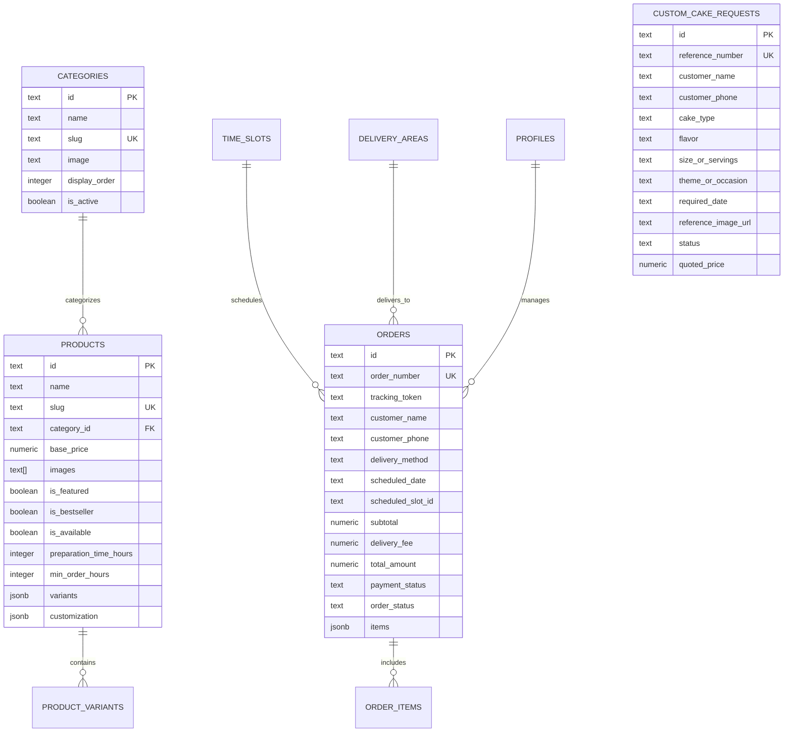

# DATABASE DESIGN & SCHEMA SPECIFICATION
**Project:** Cakes & Dessert Luxury Boutique Platform  
**Database:** Supabase PostgreSQL

---

## 1. Relational Entity Relationship Diagram

---

## 2. Table Specifications

### `public.products`
- `id` (text, primary key)
- `name` (text, required)
- `slug` (text, unique, required)
- `description` (text)
- `category_id` (foreign key -> `categories.id`)
- `base_price` (numeric(10,2))
- `images` (text array)
- `is_featured`, `is_bestseller`, `is_new`, `is_available` (boolean)
- `preparation_time_hours` (integer, default 12)
- `min_order_hours` (integer, default 6)
- `dietary_flags` (jsonb, stores eggless/vegan flags)
- `variants` (jsonb array storing portion sizes and specific tier prices)
- `customization` (jsonb storing eggless surcharge, max message characters)

### `public.orders`
- `id` (text, primary key)
- `order_number` (text, unique, e.g. `CND-2026-8921`)
- `tracking_token` (text, unguessable secure token for customer tracking)
- `customer_name`, `customer_phone`, `customer_email` (text)
- `delivery_method` ('delivery' | 'pickup')
- `delivery_address`, `delivery_pincode`, `delivery_landmark` (text)
- `scheduled_date` (date)
- `scheduled_slot_id`, `scheduled_slot_label` (text)
- `items` (jsonb snapshot of products at checkout to protect against historical price changes)
- `subtotal`, `delivery_fee`, `discount_amount`, `total_amount` (numeric(10,2))
- `payment_method_preference` ('upi' | 'bank_transfer' | 'cash_on_delivery' | 'cash_on_pickup')
- `payment_status` ('unpaid' | 'payment_pending' | 'partially_paid' | 'paid' | 'refunded')
- `order_status` ('pending' | 'contacted' | 'confirmed' | 'preparing' | 'ready' | 'out_for_delivery' | 'completed' | 'cancelled')
- `special_instructions`, `internal_notes` (text)
- `created_at`, `updated_at` (timestamps)

---

## 3. Row Level Security (RLS) Policy Matrix

| Table | SELECT | INSERT | UPDATE | DELETE |
| :--- | :--- | :--- | :--- | :--- |
| `categories` | Public | Admin Only | Admin Only | Admin Only |
| `products` | Public | Admin Only | Admin Only | Admin Only |
| `delivery_areas` | Public | Admin Only | Admin Only | Admin Only |
| `time_slots` | Public | Admin Only | Admin Only | Admin Only |
| `orders` | Admin / Token Match | Public (Guest Checkout) | Admin Only | Admin Only |
| `custom_cake_requests`| Admin Only | Public | Admin Only | Admin Only |
| `bulk_order_requests` | Admin Only | Public | Admin Only | Admin Only |
| `site_settings` | Public | Admin Only | Admin Only | Admin Only |

---

## 4. Database Migrations

The complete schema migration script is located at:
`supabase/migrations/001_initial_schema.sql`

To apply in Supabase:
1. Log into Supabase Dashboard -> Select Project -> **SQL Editor**.
2. Paste the contents of `001_initial_schema.sql`.
3. Click **Run**.

